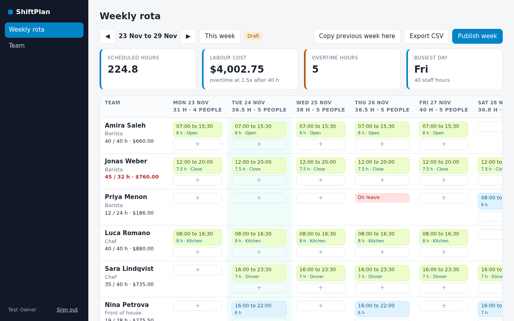
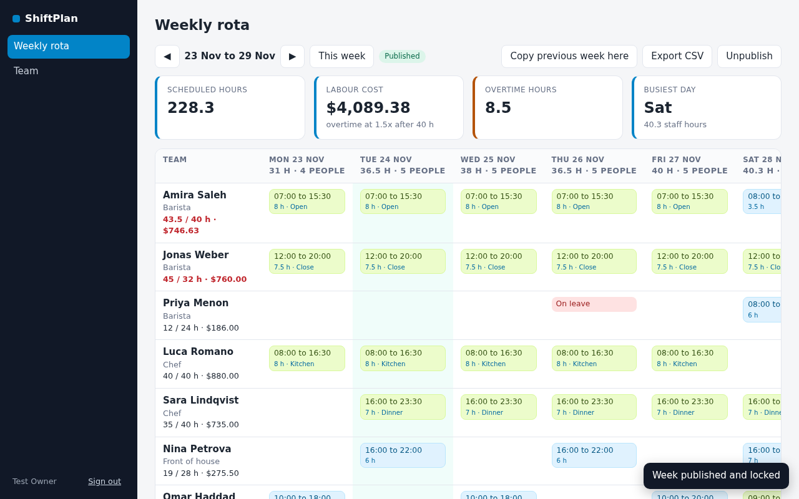
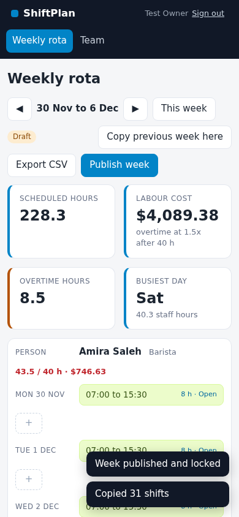

# ShiftPlan

Weekly staff rota with conflict and rest-period rules, overtime cost, publish lock and copy-week.

_Screenshots of the running app with fictional demo data (captured from the real app in Chrome)._

**Status: local demo, fictional data, not security-reviewed.**

## Features
- Weekly rota grid
- Overlap and minimum rest checks
- Overtime hours and cost
- Publish lock, copy week

## Run
Requires Node 22+ (no npm install needed).

    node server.js        # http://127.0.0.1:3000 (PORT overrides; HOST is loopback unless you set it)
    npm test              # unit and API tests
    npm run e2e           # browser test, needs google-chrome
    node docs/overflow-check.js   # phone layout: no sideways page scroll at 390 and 320 px

First run: open the page and create the owner account (username, name, password of 10+ characters). There is no built-in or default account. Setup works once per database; after that it is a normal sign-in.

## Honest limits
- Fictional seed data, local use only.
- Not security-reviewed. No HTTPS, no password reset, a single owner role. Do not expose it to a network without a reverse proxy with HTTPS and your own review.
- Tests and browser checks create a throwaway owner with a random in-memory password; nothing credential-like is stored in the repo.
- The 11-hour rest rule and the 1.5x overtime after the weekly threshold are fixed demo policy values in the code, not configurable in the UI, and not jurisdictional labour-law compliance (working-time, break and overtime law differs by country).
- Fixed UTC rules; no staff notifications.
- Data lives in a local sqlite file; back it up yourself.
